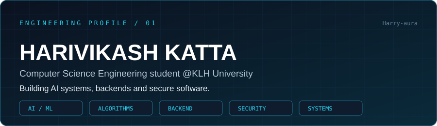
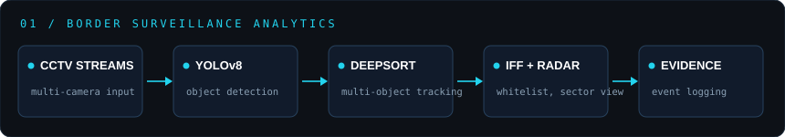
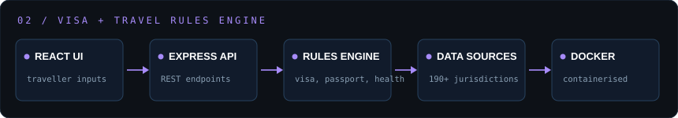
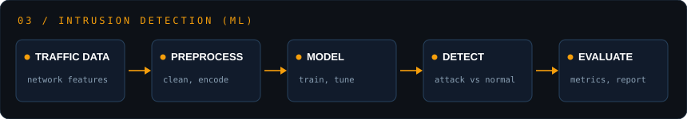
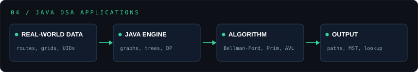

[Identity](#engineering-identity) · [Flagship](#flagship-systems) · [Algorithms](#algorithms--data-structures) · [Stack](#engineering-stack) · [Stats](#github-activity) · [Connect](#connect)

## Engineering identity

I'm **Harivikash Katta** — a Computer Science Engineering student @KLH University. I build **AI/ML systems, backend services, and algorithm-driven software** in Python, Java, C and JavaScript/TypeScript. My work focuses on correctness, clear architecture, and honest documentation of what each project does and doesn't do.

> Everything below links to real repositories. Projects are coursework, hackathon, or personal builds — not production deployments.

## Flagship systems

### 01 · Computer vision / border surveillance

**[AI-Video-Analytics-for-Border-Surveillance-CCTV](https://github.com/Harry-aura/AI-Video-Analytics-for-Border-Surveillance-CCTV)** — IBVAP V2: a real-time multi-camera surveillance command-and-control platform with YOLOv8 + DeepSORT tracking, IFF whitelisting, sector radar projection and evidence logging. Built for Smart India Hackathon.

`Python` · `OpenCV` · `YOLOv8` · `DeepSORT` · `TensorRT` · `ANPR`

### 02 · Full-stack rules engine

**[Visa-Travel-Requirements-Checker](https://github.com/Harry-aura/Visa-Travel-Requirements-Checker)** — visa and travel-requirements engine covering consular regime resolution, passport validity rules, WHO health advisories and customs controls across 190+ jurisdictions.

`React` · `Node.js` · `Express` · `REST API` · `Docker`

### 03 · Machine learning / security

**[AI-Based-Cybersecurity-Intrusion-Detection-System](https://github.com/Harry-aura/AI-Based-Cybersecurity-Intrusion-Detection-System)** — ML-based intrusion detection that classifies network activity as normal or malicious.

`Python` · `Machine Learning`

### 04 · Systems & backend
- **[shm-telemetry](https://github.com/Harry-aura/shm-telemetry)** — telemetry project written in C.
- **[Process-Termination-Message-System](https://github.com/Harry-aura/Process-Termination-Message-System)** — process-termination messaging system.
- **[Database-System-Engineering-and-Distributed-Backend-Development](https://github.com/Harry-aura/Database-System-Engineering-and-Distributed-Backend-Development)** — database and distributed-backend work in JavaScript.
- **[Shell_Innovators_OSSP](https://github.com/Harry-aura/Shell_Innovators_OSSP)** — operating-systems (shell) project in C.

## Algorithms & data structures

Each project applies a core algorithm to a real-world scenario, written in **Java**.

| Project | Algorithm / structure | Scenario |
|---|---|---|
| [Microsoft-Word-Spell-Check-Engine](https://github.com/Harry-aura/Microsoft-Word-Spell-Check-Engine-Levenshtein-Edit-Distance-) | Levenshtein edit distance | Spell-check suggestions |
| [BMTC-Bus-Route-Network](https://github.com/Harry-aura/BMTC-Bus-Route-Network-Shortest-Path-Bellman-Ford-Algorithm-) | Bellman-Ford shortest path | Bus route planning |
| [Mumbai-Power-Distribution-Grid](https://github.com/Harry-aura/Mumbai-Power-Distribution-Grid-Optimization-Prim-s-Algorithm-) | Prim's MST | Grid cost optimisation |
| [Netflix-Microservice-Ring-Network](https://github.com/Harry-aura/Netflix-Microservice-Regional-Ring-Network-Minimum-Spanning-Tree-) | Minimum spanning tree | Regional network design |
| [Amazon-Inventory-Tracking](https://github.com/Harry-aura/Amazon-Inventory-Tracking-via-AVL-Tree) | AVL tree | Inventory lookup |
| [Aadhaar-UID-De-Duplication-Registry](https://github.com/Harry-aura/Aadhaar-UID-De-Duplication-Registry) | Hashing / de-duplication | UID registry |

## More projects

[Placement-Prediction-System](https://github.com/Harry-aura/Placement-Prediction-System) (ML) · [Loan-eligibility-checker](https://github.com/Harry-aura/Loan-eligibility-checker) (Java) · [CFAI timetable generator](https://github.com/Harry-aura/CFAI) (Python) · [Portfolio](https://github.com/Harry-aura/harivikash-portfolio) (TypeScript) · [fwd-project](https://github.com/Harry-aura/fwd-project) · [fwd-programs](https://github.com/Harry-aura/fwd-programs)

## Engineering stack

| Layer | Used in projects |
|---|---|
| **Languages** | Java · Python · C · JavaScript · TypeScript · HTML |
| **AI / ML** | OpenCV · YOLOv8 · DeepSORT · TensorRT · scikit-learn-style ML pipelines |
| **Backend** | Node.js · Express · REST |
| **Frontend** | React · TypeScript |
| **DevOps** | Docker · Git · GitHub |
| **CS core** | Graphs · Trees · DP · OS / processes · Databases |

> This list describes tools used in projects, not expertise level.

## GitHub activity

## Current direction

→ Deepening backend design, testing and system design  
→ Applying ML/computer vision in real, end-to-end systems  
→ Writing tests and clear READMEs so projects stay understandable

## Connect

  

BUILD → TEST → MEASURE → IMPROVE
